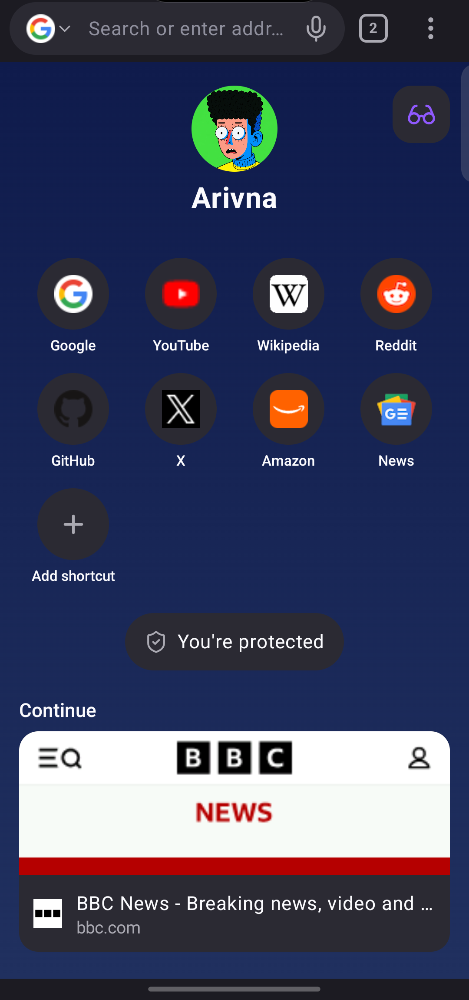
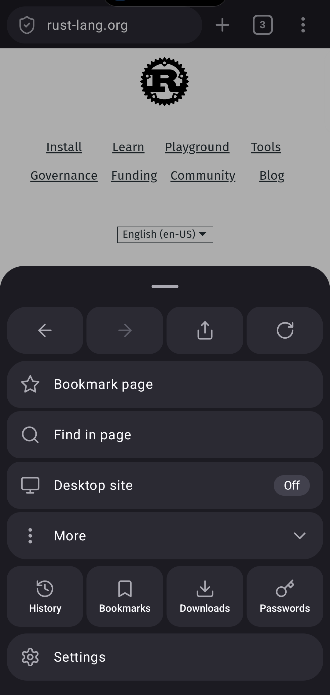
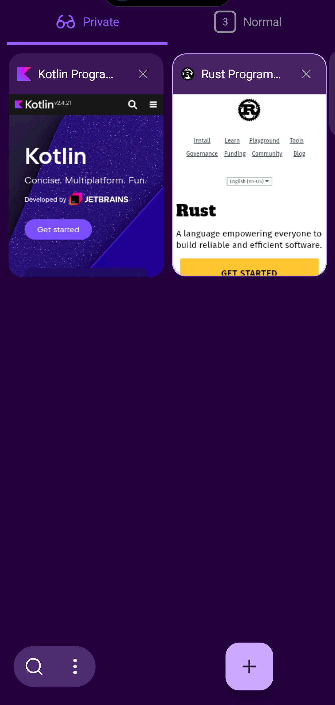
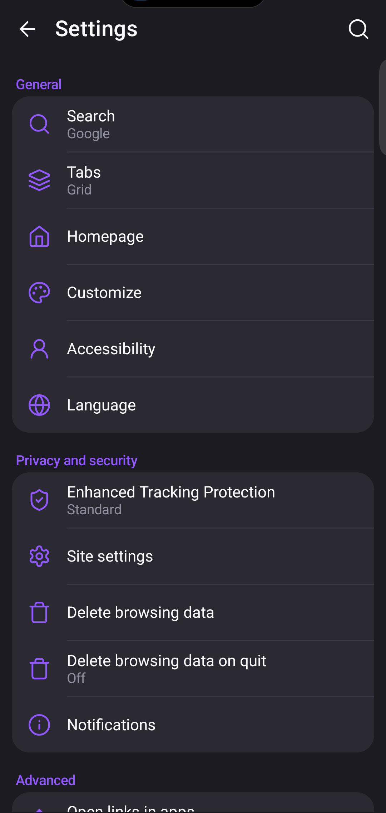
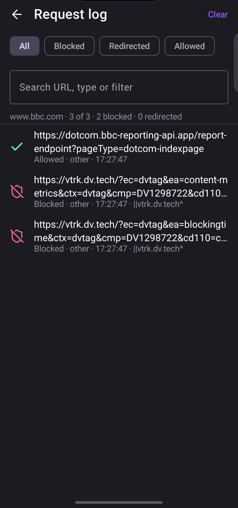
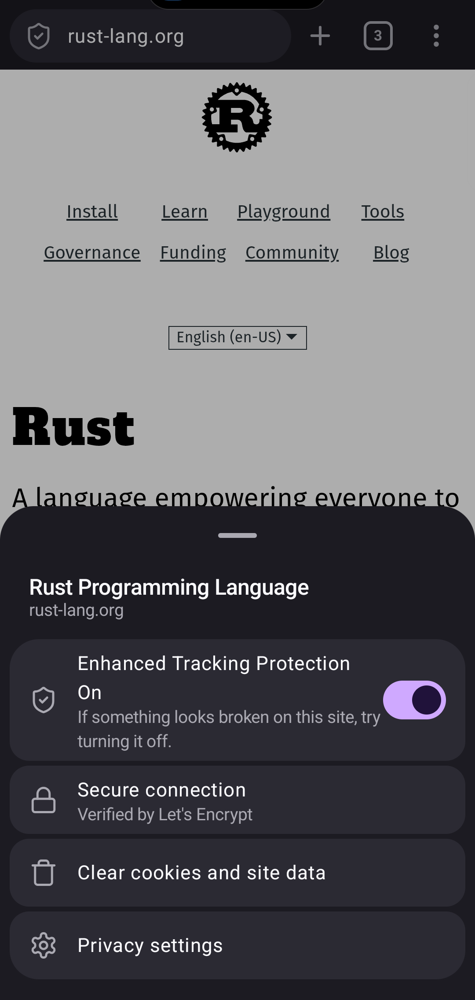
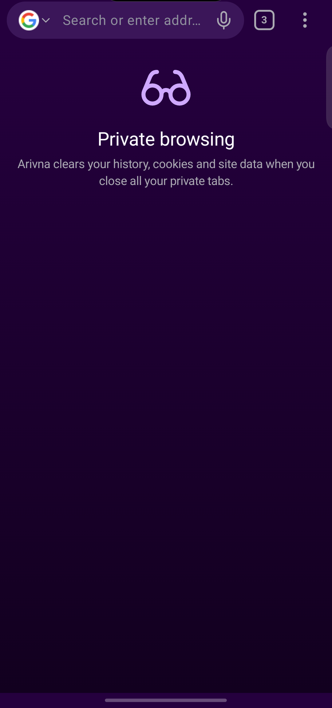
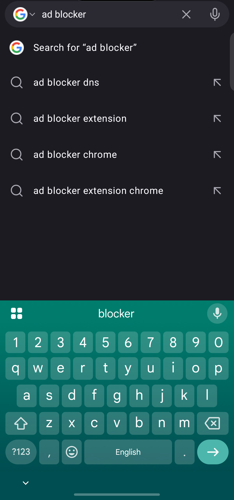

# Arivna Browser (Android)

A private web browser for Android 8.0+ with a built-in ad and tracker blocker.

- Pages are rendered by the **Android System WebView** (Chromium), the engine already on your phone. Arivna's own parts are the user interface (Kotlin, Jetpack Compose) and **Arivna Shield**, an ad-block engine written in Rust.
- Free. No ads, no account, no analytics or telemetry.
- Package `com.arivna.browser`, version 1.0.0, minSdk 26, targetSdk 36.

Website: https://arivna.in/ · Official APKs: [arivna-browser-releases](https://github.com/viroaryan/arivna-browser-releases/releases) · Google Play: coming soon.

## Screenshots

| Home | Menu | Tabs | Settings |
|---|---|---|---|
|  |  |  |  |

| Request log | Site info | Private tabs | Search |
|---|---|---|---|
|  |  |  |  |

## Features

**Arivna Shield (ad and tracker blocking)**
- Native Rust engine called through JNI. Supports uBlock Origin / Adblock Plus filter syntax: network rules, cosmetic (element hiding) rules, scriptlets, `$redirect`, `$removeparam`, `$badfilter`, `$important`, procedural cosmetic filters.
- Blocks requests before they load (`shouldInterceptRequest`) and hides leftover ad boxes.
- 13 bundled lists: uBlock Origin filters, privacy, badware, quick fixes, unbreak; EasyList; EasyPrivacy; Peter Lowe's list; URLhaus malicious URL list; AdGuard Mobile; AdGuard Tracking Protection; in strict mode also uBlock cookie notices and EasyList Cookie. Plus Arivna built-in rules and your own rules.
- Lists update daily, in parallel, with HTTP conditional requests; the engine is rebuilt only when a list changed. The compiled engine is cached to a binary file for fast start.
- Element picker, My filters, per-tab network request log (allowed / blocked / redirected, with the matching filter), per-site protection switch, popup blocking, third-party cookie blocking, Do Not Track + Global Privacy Control.

**Browsing**
- Tabs (grid or list), private tabs, recently closed tabs with Undo, auto-close old tabs.
- Full-screen search with suggestions, voice search, address bar at top or bottom.
- Reader view, find in page, desktop site, save page as PDF, add page to home screen, open in app, night mode for websites, text size, pull to refresh.
- Bookmarks with folders, history with search and time-range delete, downloads manager (parallel, background, live notification).

**Privacy controls**
- Delete browsing data, delete on quit, site permissions with per-site exceptions, open links in apps (always / ask / never), remote debugging switch (off by default).

**Not supported:** extensions, sync/accounts, built-in translation, password manager (Android autofill works), iOS or desktop.

Measured numbers and their method: [PERFORMANCE.md](PERFORMANCE.md) and [bench/REPORT.md](bench/REPORT.md).

## Project layout

```
app/                     Android app (Kotlin, Jetpack Compose)
  src/main/java/...      UI, tabs, WebView glue, downloads, storage (SQLite)
  src/main/assets/filters/  bundled filter lists (third-party, see NOTICE.md)
  src/main/jniLibs/      prebuilt libarivna_shield.so for arm64-v8a, armeabi-v7a, x86_64
  src/test/              JVM unit tests
shield-rs/               Arivna Shield, the Rust ad-block engine (see shield-rs/README.md)
  src/                   engine, JNI bindings, content script and scriptlets (src/js)
  tests/                 engine tests
  examples/              benchmark harnesses
  data/                  Public Suffix List
  build-android.sh       builds the .so for all ABIs into app/src/main/jniLibs
bench/                   comparison against uBlock Origin's engine (Node), REPORT.md
docs/                    screenshots and design notes
RELEASE.md               Google Play release checklist
PERFORMANCE.md           measurements on a real phone
```

## Build from source

### 1. Prerequisites

| Tool | Version | Needed for |
|---|---|---|
| Git | any | cloning |
| JDK | 17 | Gradle / Android build |
| Android SDK | platform 36 + build-tools 36 | the app |
| Android NDK | 27.2.12479018 | only to rebuild the Rust engine |
| Rust | stable, via rustup | only to rebuild the Rust engine |
| Git Bash | any | Windows only, to run `build-android.sh` |

The easiest way to get the SDK is Android Studio (SDK Manager: *Android 16 (API 36)*, *Build-Tools 36*, and for Rust *NDK (Side by side) 27.2.12479018*). Point Gradle at it with `local.properties` (Android Studio writes it for you; never commit it):

```properties
sdk.dir=/path/to/Android/Sdk
```

or set `ANDROID_HOME`.

### 2. Clone

```bash
git clone https://github.com/viroaryan/arivna-browser.git
cd arivna-browser
```

### 3. (Optional) Rebuild the Rust engine

Prebuilt `libarivna_shield.so` files are committed in `app/src/main/jniLibs`, so **you can skip this step** unless you change `shield-rs/`.

```bash
rustup target add aarch64-linux-android armv7-linux-androideabi x86_64-linux-android
```

`shield-rs/.cargo/config.toml` holds **absolute Windows paths** to the NDK linker (the maintainer's machine). On another machine, either edit those paths, or leave the file alone and override it with environment variables (Cargo gives them priority over config files). Use the API 26 clang wrappers:

Linux (use `darwin-x86_64` instead of `linux-x86_64` on macOS):

```bash
export NDK=$ANDROID_HOME/ndk/27.2.12479018
export TC=$NDK/toolchains/llvm/prebuilt/linux-x86_64/bin
export CARGO_TARGET_AARCH64_LINUX_ANDROID_LINKER=$TC/aarch64-linux-android26-clang
export CARGO_TARGET_ARMV7_LINUX_ANDROIDEABI_LINKER=$TC/armv7a-linux-androideabi26-clang
export CARGO_TARGET_X86_64_LINUX_ANDROID_LINKER=$TC/x86_64-linux-android26-clang
export CARGO_TARGET_AARCH64_LINUX_ANDROID_AR=$TC/llvm-ar
export CARGO_TARGET_ARMV7_LINUX_ANDROIDEABI_AR=$TC/llvm-ar
export CARGO_TARGET_X86_64_LINUX_ANDROID_AR=$TC/llvm-ar
```

On Windows the wrappers end in `.cmd` (`aarch64-linux-android26-clang.cmd`) and the archiver is `llvm-ar.exe`, under `toolchains/llvm/prebuilt/windows-x86_64/bin`.

Keep the `rustflags` line in `config.toml`: it links with `max-page-size=16384` (16 KB page alignment, required by Google Play).

Then build and test:

```bash
bash shield-rs/build-android.sh      # builds all 3 ABIs and copies them into app/src/main/jniLibs
cd shield-rs && cargo test --release # engine tests (runs on your desktop, no NDK needed)
```

### 4. Build the APK

```bash
./gradlew assembleDebug     # app/build/outputs/apk/debug/app-debug.apk
./gradlew assembleRelease   # app/build/outputs/apk/release/app-release.apk (minified with R8)
./gradlew test              # JVM unit tests
```

On Windows use `gradlew.bat` or run the same commands in Git Bash.

Without `keystore.properties`, `assembleRelease` is **signed with the debug key**: fine for testing on your own phone, not for distribution. Install with `adb install -r app/build/outputs/apk/release/app-release.apk`.

### 5. Sign your own release

Create a keystore (keep it and its passwords backed up; never commit it):

```bash
keytool -genkeypair -v -keystore my-release.jks -alias my-key -keyalg RSA -keysize 4096 -validity 10000
```

Create `keystore.properties` in the project root (git-ignored):

```properties
storeFile=/absolute/path/to/my-release.jks
storePassword=YOUR_STORE_PASSWORD
keyAlias=my-key
keyPassword=YOUR_KEY_PASSWORD
```

How `app/build.gradle.kts` uses it:
- `./gradlew bundleRelease` signs the `.aab` with this key (and fails if the file is missing).
- `./gradlew assembleRelease` run on its own keeps the debug key, so it installs over a debug build. Run `bundleRelease` as a separate command; if both are in one Gradle call, the APK is signed with your key too.

A build you sign yourself has a different signature from the official APK, so Android will not install it over the official app (uninstall first).

## Benchmarks

`bench/` compares Arivna Shield with uBlock Origin's own network engine (`@gorhill/ubo-core`) on the same lists. Needs Node.js and Rust.

```bash
cd bench
npm install
node make-corpus.mjs
cd ../shield-rs
cargo run --release --example bench_corpus -- ../app/src/main/assets/filters ../bench/lists.json ../bench/corpus.tsv ../bench/arivna-out.tsv ../bench/active
cd ../bench
node run-ubo.mjs && node diff.mjs
```

Method and results: [bench/REPORT.md](bench/REPORT.md). Engine-only timings: `cargo run --release --example bench_perf` in `shield-rs/`.

## Contributing

- Open an issue first for anything bigger than a small fix.
- Keep changes small and focused; match the existing style (Kotlin official code style, `cargo fmt` for Rust).
- Run `cargo test --release` (if you touched `shield-rs/`) and `./gradlew test assembleDebug` before opening a pull request.
- Do not commit `keystore.properties`, keystores, `local.properties` or build outputs.
- Filter lists are third-party: fix list problems upstream (uBlock Origin, EasyList, AdGuard ...), not in the bundled copies.

## Security

Please report vulnerabilities privately to **contactus@arivna.com**, not in public issues. Include the Arivna version, Android and WebView versions, and steps to reproduce. Bugs in page rendering itself usually belong to Android System WebView / Chromium.

## Licence

Arivna Browser is free software, licensed under the **GNU General Public License v3.0 or later** (GPL-3.0-or-later): see [LICENSE](LICENSE). You may use, study, share and modify it; if you distribute a modified version, you must also release its source under the same licence.

Bundled third-party components (filter lists, Rust crates, icons, libraries) keep their own licences: see [NOTICE.md](NOTICE.md).
